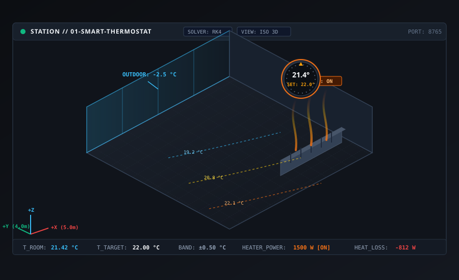
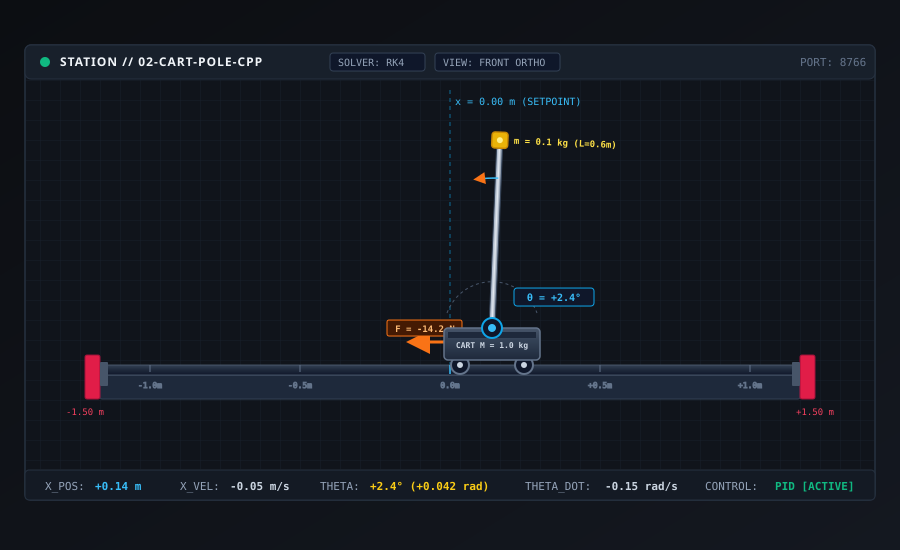
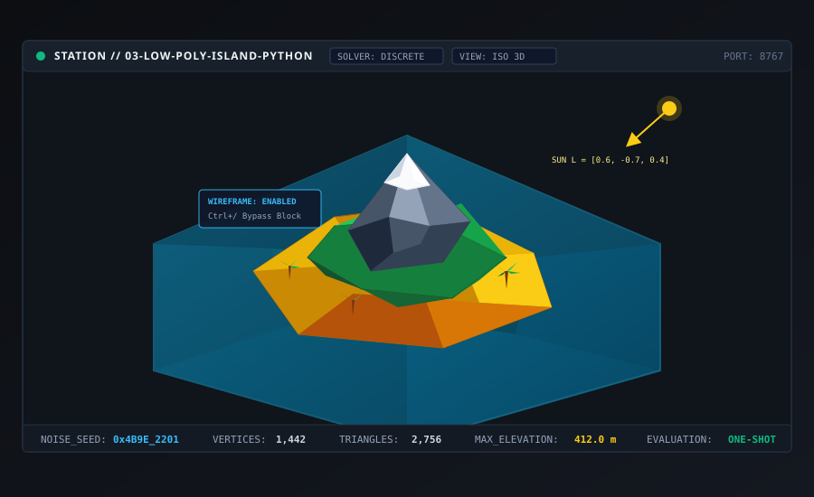
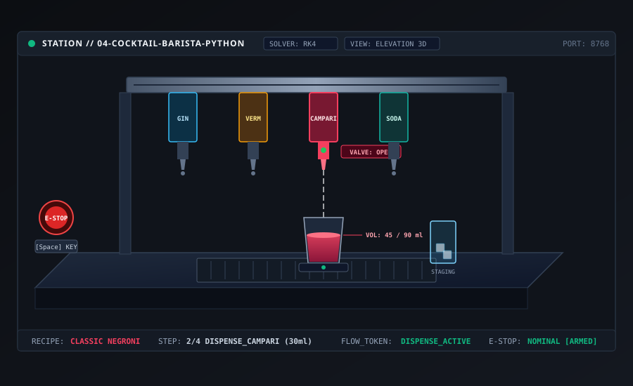
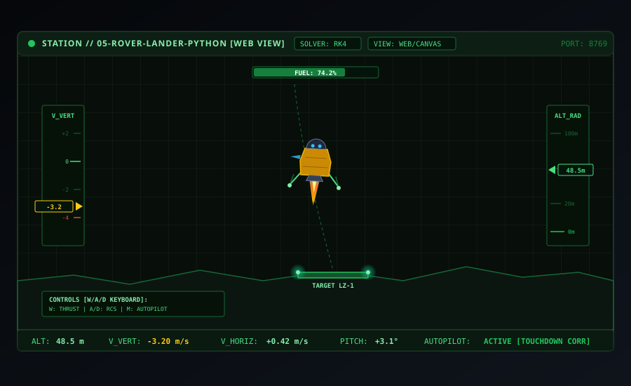
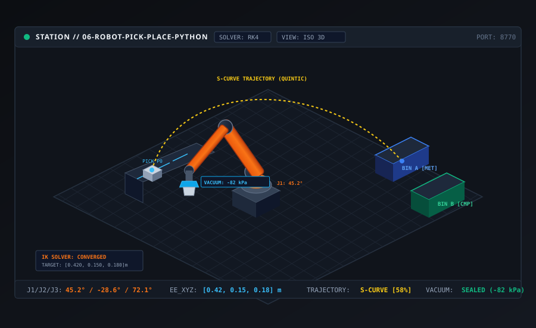
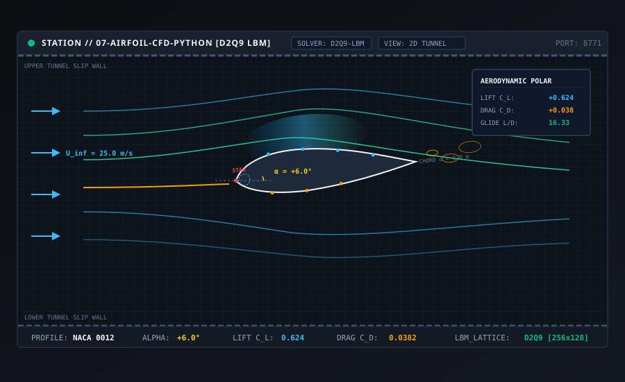
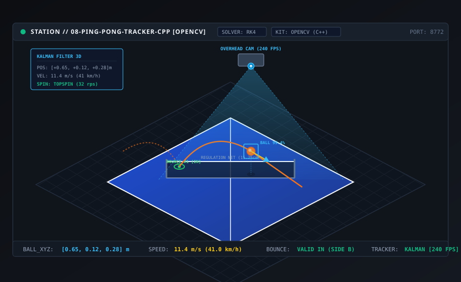
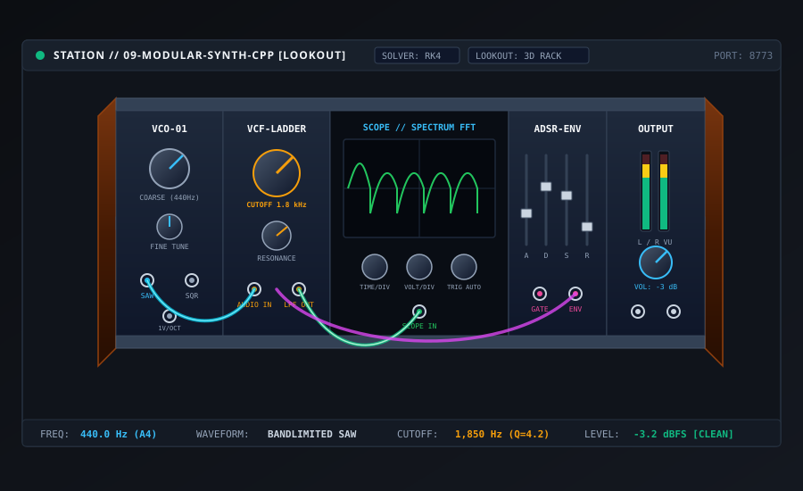
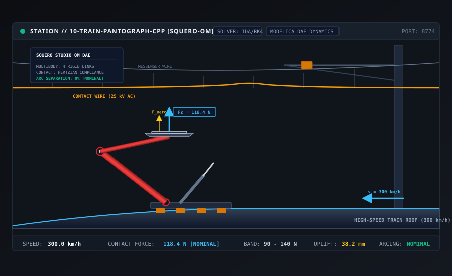

# [RFC/Plan] Redesign 10 Numbered Tutorial Examples (01-10) with Modernized Cart-Pole, Station Mockups, and Backend Manifests

**Issue Type**: Epic / RFC  
**Priority**: `P1`  
**Area**: `examples` / `curriculum`  
**Target Repository**: `paperboatlab/paperboat-examples` (cross-linked with `paperboatlab/paperboat`)  
**Status**: Ready for Implementation  

---

## 1. Executive Summary & Problem Statement

Paperboat's existing example catalog consists of 9 legacy directories (`animation-python`, `cart-pole-cpp`, `chain-python`, `double-pendulum-cpp`, `mass-spring-python`, `parametric-python`, `parts-cpp`, `runner-python`, `supply-python`). While functional, they present significant technical and pedagogical debt:
1. **Missing Modern Backend Manifests**: Backends do not include `backend.toml` (format = 0). They rely on ad-hoc CLI conventions rather than declarative metadata (`descriptor`, `solver`, `port`, `toolkits`, and `[test].golden`).
2. **Missing Pedagogical Progression**: The legacy backends are disparate physics demos rather than a structured 1-to-10 curriculum where each example introduces specific Paperboat platform features (UI cockpit modes, wire types, toolkits, acausal modeling).
3. **Underutilized UI Cockpit Capabilities**: Features such as Commander mode split views (`Alt+C`), Navigator mode, Lookout full-screen (`Alt+L`), Variables sheet formulas (`Alt+V`), custom HTML5 Web Stations, block commenting (`Ctrl+/`), visual groups (`Ctrl+G`), and degraded toolkit fallback modes are rarely or never showcased.
4. **Preserving and Modernizing Cart-Pole**: The iconic inverted pendulum benchmark (`cart-pole`) should be retained, but elevated from its untextured primitive shapes to a precision machined instrument at **Level 02** (`02-cart-pole-cpp`), complete with guide rails, travel limit stops, axle protractors, and dynamic force vectors.

This RFC establishes the definitive **10-part numbered curriculum (`01` through `10`)**, supplies production **SVG Station mockups** for all 10 examples, defines **Flow page responsibilities**, and provides a structured checklist for implementation.

---

## 2. The 10-Level Curriculum Master Table

| Level | Directory | Language | Port | Domain & Core Theme | UI Cockpit Paradigm | Core Platform Feature |
|---|---|---|---|---|---|---|
| **01** | `01-smart-thermostat-python` | Python | 8765 | **Home Thermal Comfort**: Room heat loss & bang-bang heating hysteresis | Navigator Mode | Board Wave plots, scalar float wires, `backend.toml` (format = 0) |
| **02** | `02-cart-pole-cpp` | C++ | 8766 | **Modernized Cart-Pole Control**: Inverted pendulum balancing on precision rail | Commander Split View | Variables sheet (`Alt+V`) formulas (`kd = kp / 5`), high-frequency C++ RK4, PID |
| **03** | `03-low-poly-island-python` | Python | 8767 | **Creative Coding / Game Worlds**: Procedural archipelago terrain generation | Navigator Mode | One-shot static evaluation (`solver = "discrete"`), list/array wires, block commenting (`Ctrl+/`) & bypass (`Ctrl+Shift+Y`) |
| **04** | `04-cocktail-barista-python` | Python | 8768 | **Robotics / Process Automation**: Automated drink recipe execution | Inspector Mode | Step flow tokens, Visual Groups (`Ctrl+G`), Subsystems, emergency stop keyboard keys (`Key`), Console logs |
| **05** | `05-rover-lander-python` | Python | 8769 | **Spacecraft Arcade Simulation**: Lunar module soft-touchdown autopilot | Custom Web Station | Custom HTML5/Canvas CRT cockpit (`[station] view = "web"`), human keyboard play vs autonomous thruster autopilot |
| **06** | `06-robot-pick-place-python` | Python | 8770 | **Articulated Industrial Robotics**: 3-DOF robot arm pick-and-place | Commander Split View | Inverse kinematics (IK) block, quintic S-curve trajectory planning, vacuum gripper picking |
| **07** | `07-airfoil-cfd-python` | Python | 8771 | **Aerodynamics & Fluid Dynamics**: 2D Computational Fluid Dynamics over arbitrary shape | Navigator Mode | Lattice Boltzmann (D2Q9) grid, 2D velocity vector heatmap, streamlines, lift & drag polar gauges ($C_L, C_D$) |
| **08** | `08-ping-pong-tracker-cpp` | C++ | 8772 | **Sports Analytics / Computer Vision**: Table tennis ball tracking & spin estimation | Commander Split View | OpenCV C++ toolkit integration, image wire buffers, Board Image View tiles, degraded fallback (`#ifdef PAPERBOAT_HAS_OPENCV`) |
| **09** | `09-modular-synth-cpp` | C++ | 8773 | **Music Production & Audio Tech**: Polyphonic modular analog synth & vocoder | Lookout Mode (`Alt+L`) | Vector state wires `[6]`, advanced Scope (FFT spectrum, measurement cursors, triggers), knurled 3D Eurorack chassis |
| **10** | `10-train-pantograph-cpp` | Modelica & C++ | 8774 | **High-Speed Rail / Multibody Dynamics**: High-speed train pantograph & catenary contact | Commander Split View | Squero Studio OM acausal schematic, catenary compliance, active force regulation, `.ppk` pack |

---

## 3. Visual Station Mockups Gallery

Each example includes a high-resolution, vector-crisp Station mockup residing in `paperboat-examples/assets/mockups/` styled to Paperboat's instrument aesthetic:

### Level 01: Smart Thermostat
**Path**: `assets/mockups/01-smart-thermostat-station.svg`  
Modern living room cross-section with glass outdoor thermal boundary ($-2.5^\circ\text{C}$), convection baseboard radiator with rising thermal heat plumes, round digital thermostat dial (`21.4°C` actual vs `22.0°C` setpoint), and telemetry HUD.


---

### Level 02: Modernized Cart-Pole
**Path**: `assets/mockups/02-cart-pole-station.svg`  
Linear precision ground steel guide rail ($-1.5\,\text{m}$ to $+1.5\,\text{m}$) with hard end-stops, machined aluminum cart ($M = 1.0\,\text{kg}$), sealed axle bearing with degree protractor ($\theta = +2.4^\circ$), carbon-fiber pole with brass bob ($m = 0.1\,\text{kg}$), and dynamic horizontal actuation force vector arrow ($F_{\text{cmd}} = -14.2\,\text{N}$).


---

### Level 03: Procedural Low-Poly Island
**Path**: `assets/mockups/03-low-poly-island-station.svg`  
Procedurally generated 3D low-poly archipelago floating in flat stylized turquoise ocean water, mountain ridges, snowy peak summit, sandy beaches, coconut palms, and solar incident vector $\vec{L} = [0.6, -0.7, 0.4]$ casting facet shadows.


---

### Level 04: Cocktail Barista Machine
**Path**: `assets/mockups/04-cocktail-barista-station.svg`  
Stainless steel automated beverage bar with overhead gantry dispensing Gin, Vermouth, Campari, and Soda, active fluid streams pouring into a motorized mixing tumbler on a rotary cradle, staged highball serving glass, and emergency stop button.


---

### Level 05: Lunar Rover Lander
**Path**: `assets/mockups/05-rover-lander-station.svg`  
Custom Web Station HTML5/Canvas CRT cockpit interface, radar grid, cratered lunar horizon, green beacon landing pad (`LZ-1`), descending lunar lander with orange rocket flame and blue RCS thruster bursts, vertical velocity tape, radar altitude tape, and fuel gauge.


---

### Level 06: Articulated Robot Pick-and-Place
**Path**: `assets/mockups/06-robot-pick-place-station.svg`  
3-DOF industrial robotic arm in safety orange mounted to a heavy cast pedestal base, vacuum suction gripper head picking metallic cylinders from an infeed conveyor, smooth quintic S-curve trajectory arc, and two color-coded sorting bins (`BIN A` and `BIN B`).


---

### Level 07: 2D Airfoil Wind Tunnel CFD
**Path**: `assets/mockups/07-airfoil-cfd-station.svg`  
Wind tunnel test section showing Lattice Boltzmann D2Q9 grid lattice, NACA 0012 symmetric airfoil profile at angle of attack $\alpha = +6.0^\circ$, incoming airflow ($U_\infty = 25.0\,\text{m/s}$), suction surface acceleration contours, stagnation point, wake vortex shedding, and live lift/drag polar box ($C_L = 0.624, C_D = 0.0382, L/D = 16.3$).


---

### Level 08: Ping-Pong Ball Tracker
**Path**: `assets/mockups/08-ping-pong-tracker-station.svg`  
Regulation blue table tennis table with white lines and net, overhead truss-mounted high-speed camera (240 FPS) with translucent blue optical frustum pyramid, orange ball mid-air, 3D parabolic bounce trajectory ribbon, bounding box, and OpenCV Kalman tracking card.


---

### Level 09: Modular Eurorack Synthesizer
**Path**: `assets/mockups/09-modular-synth-station.svg`  
Full-width Eurorack chassis with stained walnut side cheeks, modular faceplates (VCO-01, VCF Resonant Ladder, Digital FFT Scope, ADSR Envelope, Master Output with stereo LED VU bars), and neon glowing patch cables draped across jacks.


---

### Level 10: High-Speed Train Pantograph & Catenary
**Path**: `assets/mockups/10-train-pantograph-station.svg`  
High-speed electric train roofline traveling at $300\,\text{km/h}$, single-arm articulated pantograph linkage, overhead catenary messenger wire and droppers, contact wire uplift wave, upward contact force vector ($F_c = 118.4\,\text{N}$), aerodynamic uplift arrow, and Squero Studio OM acausal multibody status card.


---

## 4. Flow Page Functional Responsibilities

Every example pairs its 3D/2D Station view with an active, functional **Flow schematic**:

```
 ┌──────────────────────────────────────────────────────────────┐
 │ Flow Block Diagram (Causal signal & control graph)           │
 │  [Sensor/Input] ──► [Math / Filter / FSM] ──► [Actuator/Out] │
 └──────────────────────────────┬───────────────────────────────┘
                                │ State feedback & Commands
 ┌──────────────────────────────▼──────────────────────────────┐
 │ Station 3D/2D View (Physics & Visual Telemetry)              │
 └──────────────────────────────────────────────────────────────┘
```

1. **01 Smart Thermostat**: `AmbientTemp` + `HeaterPower` feed a continuous thermal transfer block (`dT/dt = (Q_in - Q_loss) / C_room`). Output feeds a `HysteresisComparator` ($T_{\text{target}} \pm 0.5^\circ\text{C}$), generating boolean heater drive to both baseboard coil and Board wave plot.
2. **02 Cart-Pole**: State vector $[x, \dot{x}, \theta, \dot{\theta}]$ passes into an interactive `PIDController` block. Formula bindings calculate $K_d = K_p / 5$. Output $F_{\text{cmd}}$ clamps to actuator rail limits ($\pm 25\,\text{N}$) and drives the physical cart.
3. **03 Low-Poly Island**: Non-temporal static graph. Parameter blocks (`Seed`, `Octaves`, `Persistence`, `SeaLevel`) feed a 2D Simplex Noise generator block producing height array wires `float[N]`. A geometry generator block outputs polygonal mesh buffers. Block bypass (`Ctrl+Shift+Y`) allows isolating noise octaves.
4. **04 Cocktail Barista**: Visual Groups (`Ctrl+G`) isolate recipe subsystems. Flow tokens step through sequential states (`STAGE_CUP` $\to$ `DISPENSE_GIN` $\to$ `DISPENSE_CAMPARI` $\to$ `STIR` $\to$ `POUR`). Keyboard block (`Key::Space`) triggers instant E-Stop latch.
5. **05 Rover Lander**: Dual-input multiplexer block switches between manual keyboard controls (`Key::W`, `Key::A`, `Key::D`) and an autonomous soft-touchdown state machine (`DescentGuidance`). Calculates thruster throttling to keep touchdown descent velocity below $2.0\,\text{m/s}$.
6. **06 Robot Arm**: Target coordinate input $[X, Y, Z]$ passes into an `InverseKinematics` block computing joint angles $[\theta_1, \theta_2, \theta_3]$. A `TrajectoryInterpolation` block generates quintic S-curves, feeding velocity limits and vacuum seal logic.
7. **07 Airfoil CFD**: Input profile block (loads SVG bezier path or NACA 4-digit code) sets boundary wall conditions on a Lattice Boltzmann D2Q9 collision-streaming solver block. Momentum exchange blocks integrate surface pressure taps into continuous $C_L$ and $C_D$ scalar signals.
8. **08 Ping-Pong Tracker**: Video frame input block feeds an OpenCV image processing subsystem (HSV color thresholding, contour extraction, center-of-mass centroid). Output pixel coordinates feed a 3D Kalman filter tracking state vector $\mathbf{x} = [x, y, z, \dot{x}, \dot{y}, \dot{z}]^T$.
9. **09 Modular Synth**: Audio-rate polyphonic graph. Note CV input feeds polyphonic `VCO` blocks producing raw bandlimited waveforms. Wires route into a 4-pole resonant `LadderVCF` block modulated by an `ADSR` generator. Audio buffers route to an `FFT_Analyzer` block feeding the live Scope.
10. **10 Train Pantograph**: High-level contact force regulator in Flow computes pneumatic cylinder pressure commands ($P_{\text{act}}$) to counter aerodynamic uplift ($F_{\text{aero}} = \frac{1}{2}\rho v^2 C_{\text{lift}}$), stabilizing contact wire forces within the $90\text{--}140\,\text{N}$ window.

---

## 5. Modernized Cart-Pole Specification (Level 02)

Cart-Pole is upgraded to modern Paperboat standards:

### 5.1 Physical System & Constants
- **Cart Mass ($M$)**: $1.0\,\text{kg}$
- **Pole Mass ($m$)**: $0.1\,\text{kg}$
- **Pole Half-Length ($l$)**: $0.5\,\text{m}$ (full pole length $1.0\,\text{m}$)
- **Rail Travel Limits**: $x \in [-1.50\,\text{m}, +1.50\,\text{m}]$ (hard rubber stops)
- **Actuation Limit**: $F_{\text{clamp}} \in [-25.0\,\text{N}, +25.0\,\text{N}]$
- **Equations of Motion**:
  $$\ddot{\theta} = \frac{g \sin\theta + \cos\theta \left( \frac{-F - m l \dot{\theta}^2 \sin\theta}{M + m} \right)}{l \left( \frac{4}{3} - \frac{m \cos^2\theta}{M + m} \right)}$$
  $$\ddot{x} = \frac{F + m l \left( \dot{\theta}^2 \sin\theta - \ddot{\theta}\cos\theta \right)}{M + m}$$

### 5.2 Manifest Specification (`backend.toml`)
```toml
format = 0
name = "02-cart-pole-cpp"
version = "0.2.0"
language = "cpp"
run = "build/paperboat-cart-pole"
port = 8766
descriptor = "descriptor.toml"
solver = "rk4"

[test]
golden = "expected.json"
```

### 5.3 Variables Sheet Formulas (`Alt+V`)
- `kp_theta`: Slider, range $[0.0, 100.0]$, default `45.0`
- `kd_theta`: Formula `= kp_theta / 5.0` ($9.0\,\text{N}\cdot\text{s}/\text{rad}$)
- `kp_x`: Slider, range $[0.0, 20.0]$, default `2.5`
- `kd_x`: Formula `= kp_x / 2.0` ($1.25\,\text{N}\cdot\text{s}/\text{m}$)

---

## 6. Implementation & Verification Plan

### Phase 1: Directory Structure & Manifests
- Scaffold 10 directories in `paperboat-examples`:
  - `01-smart-thermostat-python/`
  - `02-cart-pole-cpp/`
  - `03-low-poly-island-python/`
  - `04-cocktail-barista-python/`
  - `05-rover-lander-python/`
  - `06-robot-pick-place-python/`
  - `07-airfoil-cfd-python/`
  - `08-ping-pong-tracker-cpp/`
  - `09-modular-synth-cpp/`
  - `10-train-pantograph-cpp/`
- Every directory must contain:
  - `backend.toml` (format = 0)
  - `descriptor.toml` (ISA-88 state machines, signals, parameters)
  - `expected.json` (golden run data for validation)
  - `README.md` (tutorial instructions and step-by-step walk-through)
  - Domain implementation source files

### Phase 2: Engine CLI & Discovery Updates (`paperboat`)
- Update `paperboat/engine/core/src/backend_manager.cpp` to discover numbered prefixes (`paperboat run 1` or `paperboat run 01` resolves to `01-smart-thermostat-python`).
- Update root `npm run example:<name>` scripts.

### Phase 3: Sphinx Documentation (`paperboat/docs/api/tutorials.rst`)
- Overhaul `paperboat/docs/api/tutorials.rst` to structure the complete 10-chapter curriculum, embedding the SVG mockups from `paperboat-examples/assets/mockups/`.

---

## 7. Acceptance Criteria ("Done When")

- [x] All 10 visual Station mockups created in `paperboat-examples/assets/mockups/*.svg` and validated with `xmllint`.
- [x] Comprehensive RFC & issue document written to `paperboat-examples/docs/issue_numbered_tutorials.md`.
- [ ] 10 example backend directories scaffolded with `backend.toml`, `descriptor.toml`, `expected.json`, and `README.md`.
- [ ] Modernized Cart-Pole (`02-cart-pole-cpp`) compiles and balances stably under PID control.
- [ ] Golden verification script `python3 paperboat/protocol/golden.py --examples paperboat-examples <name>` passes for all implemented backends.
- [ ] `paperboat check` passes across all backend manifests.
- [ ] Sphinx documentation builds cleanly (`npm --prefix paperboat run docs`).
