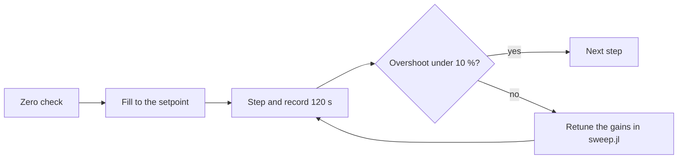

# Tank characterisation v2

Step tests at three levels, now that the sensor is zeroed ([[protocol-level-sensor]]) and its drift
above 8 cm is known ([[sensor-drift]]). The first one is done: [[step-response-5cm]].

| Step | Setpoint [cm] | Pump limit | Gains | Status |
| :--- | ---: | ---: | :--- | :---: |
| 1 | 5 | 60 % | kp 40, ki 2 ([[pump-check]]) | done |
| 2 | 10 | 60 % | kp 40, ki 2 | open |
| 3 | 15 | 80 % | from `sweep.jl` | open |

Each step, in order:

> [!todo] Before step 3
> Raise the pump limit to 80 % and check that the outlet valve is fully open.
